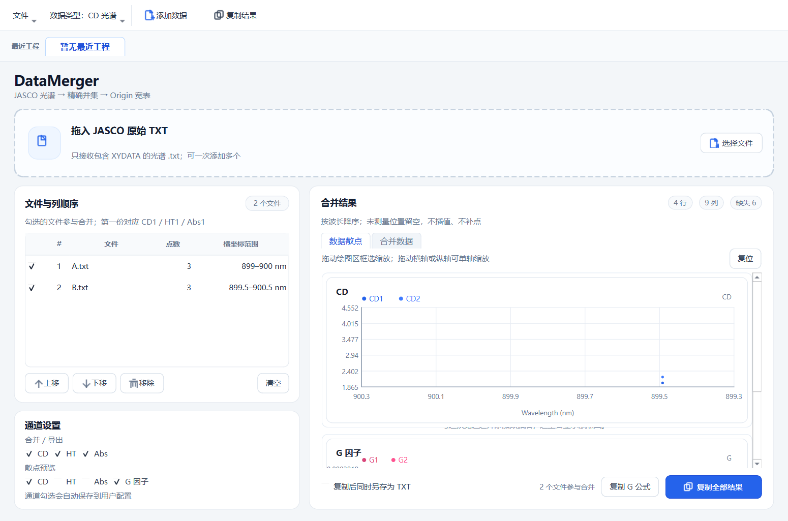

# DataMerger

本地运行的 CD 光谱与 CHI 电化学数据合并工具。输出面向 Origin 的制表符宽表，不插值、不补造测量点。



## 功能

### CD 光谱

- 只读取包含单个 `XYDATA` 数据区的 JASCO `.txt`。
- 按波长精确并集合并，`1e-6 nm` 内的波长视为同一点。
- 按波长降序排列，空缺列保持空白。
- 可勾选 `CD`、`HT`、`Abs` 输出通道。
- 主复制结果包含可直接绘图的 G 数值列。
- “复制 G 公式”可将真正的 Origin `F(x)=` 公式粘贴到对应单元格。
- 默认生成 `CD`、`G 因子` 两张散点预览图。

### 电化学

- 只读取 CHI 导出的 `.txt`；拖入的 `.bin` 在电化学模式下直接忽略。
- 根据表头自动识别横坐标：
  - `Potential/V` → 电位
  - `Time/sec` → 时间
  - `Freq (Hz)` → 频率
  - 也支持容量、波长及通用 `X` 表头
- 第一列固定为识别出的横坐标，之后的列按“文件顺序 + 文件内数据列顺序”排列。
- 相同横坐标精确并集，空缺留白，不插值。
- 电位、时间等不同横坐标的文件不能合并到同一张表。
- CV 往返扫描中重复出现的电位按第 1 次、第 2 次……出现顺序对齐，完整保留正反扫数据。
- 不生成公式列，也不预计算任何派生数据。
- 默认绘制发现到的全部电化学通道散点图。

## 工具栏与工程文件

工具栏包含：

- 文件：新建、打开、保存、另存为、关闭工程。
- 数据类型：`CD 光谱`、`电化学`。
- 添加数据、复制结果。
- 下方“最近工程”横向标签栏，可快速切换最近打开的工程。

工程文件使用 `.dmproj`，本质是可读 JSON。只保存源文件绝对路径和每个文件的勾选状态，不复制源数据：

```json
{
  "format": "DataMergerProject",
  "version": 1,
  "data_type": "electrochem",
  "files": [
    {
      "path": "F:\\Data\\sample.txt",
      "enabled": true
    }
  ]
}
```

最近工程索引保存在程序同目录的 `DataMerger-recent.json`。程序不向用户目录或 C 盘写入工程缓存。

## 用户通道配置

“合并 / 导出”和“散点预览”的通道勾选会自动保存到程序同目录的 `DataMerger-config.json`。该配置跨工程复用，不写入工程文件或 C 盘用户目录。

默认值：

- CD 合并/导出：`CD`、`HT`、`Abs`
- CD 散点预览：`CD`、`G`
- 电化学合并/导出与散点预览：当前数据中发现的全部通道

散点预览直接读取最终导出表。图中每个样本使用不同颜色，不插值、不额外计算。

预览交互：

- 在绘图区拖动框选，可同时缩放 X/Y 范围。
- 在横轴附近横向拖动，只缩放 X 范围。
- 在纵轴附近纵向拖动，只缩放 Y 范围。
- 顶部“复位”按钮可一次恢复所有图的完整坐标范围。

## 开发环境

界面颜色、字体、弹窗、标签栏、对比度与图表配色遵守
[`DESIGN_SYSTEM.md`](DESIGN_SYSTEM.md)。主题入口统一为 `theme.apply_theme()`。

```powershell
Set-Location 'F:\coding\DataMerger'
& 'F:\coding\python3\python3itself\python.exe' -m venv .venv
& '.\.venv\Scripts\python.exe' -m pip install -r requirements-build.txt
```

运行源码：

```powershell
& '.\.venv\Scripts\pythonw.exe' .\app.py
```

测试：

```powershell
$env:QT_QPA_PLATFORM = 'offscreen'
& '.\.venv\Scripts\python.exe' -m unittest discover -s tests -p 'test_*.py' -v
```

## 构建

```powershell
& '.\verify_and_build.ps1'
```

构建产物：

```text
dist\DataMerger\DataMerger.exe
```

生成便携分发包：

```powershell
& '.\.venv\Scripts\python.exe' .\package_portable.py
```

输出：

```text
release\DataMerger Win11 x64.zip
```

默认使用本机自签名证书。该签名可验证文件签名后未被修改，但不会自动获得公共 CA 或 SmartScreen 信任。
